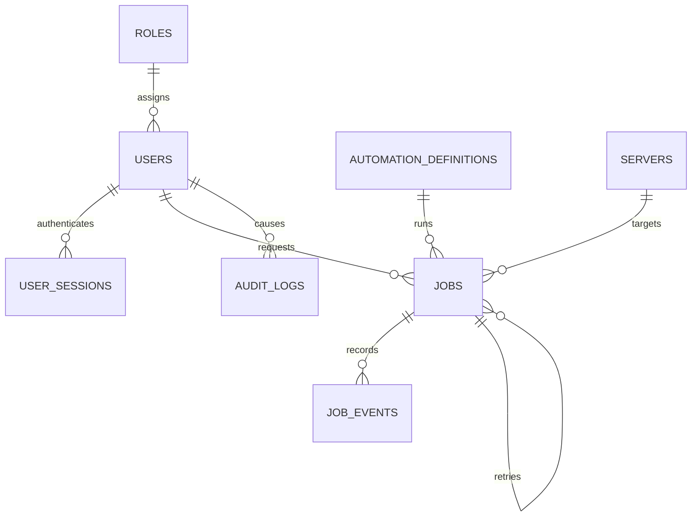

# Architecture

## Component responsibilities

- **React/Vite portal**: login, approved automation catalogue, validated submission forms, job tracking, history, server administration, and audit visibility.
- **Replit preview API**: Express/TypeScript adapter using the workspace's shared Drizzle/PostgreSQL service. It runs with `MOCK_MODE=true` and persists the complete mock workflow.
- **Linux production API**: FastAPI/Python 3.12 with SQLAlchemy and Alembic. The API validates requests, enforces roles, writes audit and job events, and places work in PostgreSQL.
- **Linux worker**: separate Python process that atomically claims pending jobs and invokes only registry-approved Ansible playbooks.
- **Ansible**: connects from the Linux automation host to one registered Windows server through WinRM HTTPS on port 5986.
- **Windows PowerShell scripts**: fixed scripts installed under `C:\Automation`; the web client cannot choose a path or submit a command.
- **PostgreSQL**: users, roles, registered targets, automation definitions, jobs, timelines, settings, and append-only audit events.

## Request and execution flow

1. A user authenticates through a server-side HTTP-only session.
2. The frontend requests the catalogue and target list from `/api/v1`.
3. A submission includes an automation ID, registered server ID, parameter values, business reason, change reference when required, and confirmation.
4. The API loads the registered automation and server, validates role and parameter schema, and persists a pending job plus job/audit events. It returns HTTP 202 with the job ID.
5. A worker claims the row with a database lock, records progress, and either simulates a run or invokes Ansible.
6. Ansible uses a one-host temporary inventory and a JSON extra-vars file with restrictive permissions. The browser never receives Windows credentials.
7. The API sanitizes output before persistence and again before returning it. The UI polls job and event endpoints.

## Security boundaries

- The automation API accepts identifiers and parameter values, never a playbook path, script path, inventory path, command, shell argument, or unrestricted extra-vars object.
- Playbooks and PowerShell script keys are checked against server-side registries.
- The target hostname and target name are validated; each Ansible process is limited to the single selected registered host.
- Windows credentials come from protected environment variables on the Linux host. They are not part of the database, source tree, inventory, UI, or logs.
- Sessions are opaque, database-backed, expiring, and stored in an HTTP-only cookie. Mutations use a CSRF token and origin checks.
- Role checks are enforced by the API, not only by hidden navigation links.
- Audit events are append-only through application routes; users cannot edit or remove them.
- Viewer job history is restricted to the viewer's own jobs.

## Database relationships



## Mock mode versus production mode

`MOCK_MODE=true` is the Replit/local default. It does not call `ansible-playbook`, does not contact a Windows host, and runs a 2–8 second simulation with events, success/failure/timeout outcomes, database history, and a visible mock indicator.

`MOCK_MODE=false` is for the Linux automation host only. It also requires `ANSIBLE_ENABLED=true`, `WINDOWS_USERNAME`, `WINDOWS_PASSWORD`, a configured Ansible working directory, and a Windows host reachable over HTTPS/5986. Missing production configuration fails safely. Real WinRM connectivity has not been tested from Replit; it must be verified from the Linux host.

## Why the browser never talks directly to Windows

The browser communicates only with the portal API. Keeping network access, credentials, playbook selection, and command execution on the Linux host prevents browser users from bypassing validation and reduces exposure of Windows management interfaces.

## Request sequence

```mermaid
sequenceDiagram
  actor User
  participant UI as React portal
  participant API as FastAPI
  participant DB as PostgreSQL
  participant Worker
  participant Ansible
  participant Win as Windows Server
  User->>UI: Submit approved automation
  UI->>API: POST /api/v1/jobs
  API->>DB: Validate records; insert job and audit events
  API-->>UI: 202 Accepted + job ID
  Worker->>DB: Claim pending job with row lock
  Worker->>Ansible: Run registry-approved playbook
  Ansible->>Win: WinRM HTTPS :5986
  Win-->>Ansible: Structured PowerShell result
  Ansible-->>Worker: Exit code and output
  Worker->>DB: Save sanitized status, events, output
  UI->>API: Poll job and events
  API-->>UI: Sanitized job state
```
